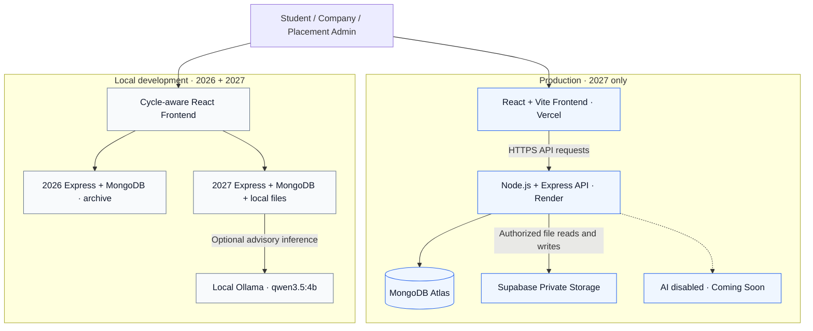
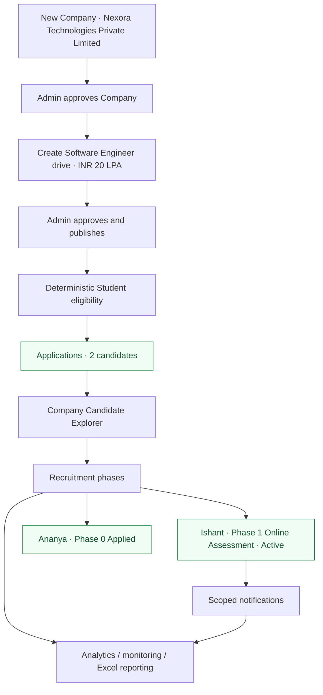
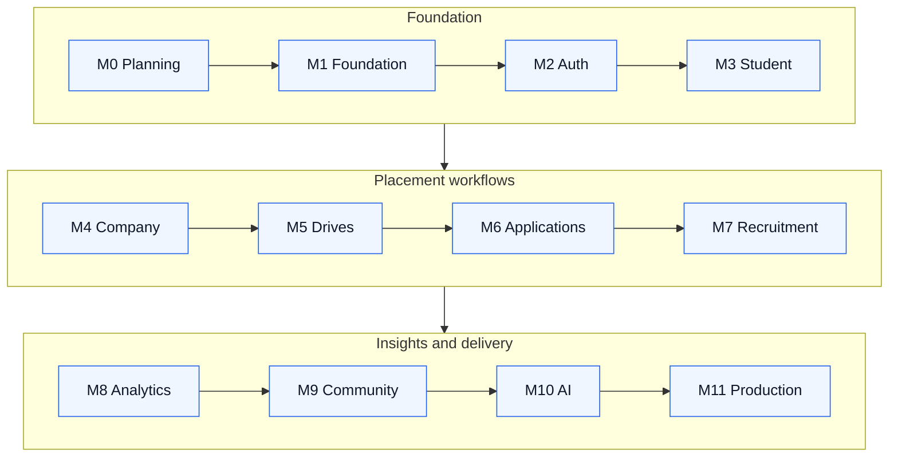

<div align="center">

# PlacementHub-V2

### From professional profiles to verified placement outcomes.

A MERN placement-management platform for one college, three roles, and the complete recruitment journey.

**[Live Frontend](https://placement-hub-v2.vercel.app) · [Backend](https://placementhub-v2.onrender.com) · [API Health](https://placementhub-v2.onrender.com/api/v1/health)**

<p>
  
  
  
  
  
  
  <br />
  
  
  
  
</p>


*Existing landing-page artwork; not a dashboard screenshot.*

**2027-only production · Private documents · Local advisory AI**

[Features](#role-experiences) · [Architecture](#system-architecture) · [Acceptance](#final-live-acceptance) · [Run Locally](#run-locally) · [Documentation](#documentation)

</div>

---

## Overview

PlacementHub-V2 connects Student preparation, Company recruitment and Placement Admin oversight. Verified profiles, approved drives, deterministic eligibility, applications, recruitment phases, confirmed outcomes and reporting share one authorized workflow.

**M0–M11 functionality is complete and deployed.** The core live end-to-end workflow passed successfully. A known Vercel nested-route refresh/direct-access limitation remains documented below; this is not a claim of zero-defect production acceptance.

## Role experiences

| Student | Company | Placement Admin |
| :--- | :--- | :--- |
| Register/login; build a professional profile with academics, skills and projects | Register/login; complete Company profile, policy acceptance and Admin approval | Verify Students, approve Companies and maintain institution/placement oversight |
| Upload resume/documents; accept policy; complete verification | Create drive proposals, eligibility criteria and recruitment phases | Approve and publish drives; monitor recruitment and placement outcomes |
| Browse drives, inspect deterministic eligibility and apply | Explore candidates, inspect applicant profiles and access authorized resumes | Use dashboards, analytics, reports and Excel exports |
| Follow Recruitment Journey, instructions, PDFs and notifications | Review objective match scores, advance candidates and send scoped notifications | Search Students by name, Group by Branch and filter candidate pools |
| Participate in Community posts, articles, profiles, likes and comments | Share professional Community content and receive notifications | Participate in Community and apply ownership/moderation rules |
| Local Career AI and Drive AI | Local Candidate AI and bounded comparisons | Local Placement AI insights and grounded data questions |

**Rules stay authoritative:** AI never determines eligibility, applies for a Student, advances a candidate or confirms a placement. Community activity does not affect professional scoring. Production AI areas display **Coming Soon** while deterministic features remain available.

## System architecture



The Express backend owns authorization and business rules; MongoDB stores application records. Supabase stores private PDFs and images in `placementhub-2027`. Protected files travel through authenticated backend routes after domain authorization—no public raw storage URLs, provider keys or internal storage references are exposed to clients.

The backend is a modular monolith with domain routes, controllers, services, Zod validation and Mongoose models. Frontend pages compose features and call API services. Local AI is mediated by the **2027 backend**, not called directly by the browser or the archived runtime.

## End-to-end placement journey



Companies define 1–5 recruitment phases; Phase 0 is system-owned. Authorized transitions preserve application history. Selection and confirmed placement remain separate outcomes, backed by the appropriate review/proof workflow.

## Local vs production

| Capability | Local | Production |
| :--- | :--- | :--- |
| Placement cycle | 2026 archived + 2027 current | **2027 only** |
| Frontend | Vite development server; cycle-aware sessions | React/Vite build on Vercel |
| Backend | Separate Express runtimes: 2026 on 5000, 2027 on 5001 | Render Express API; Node 24.x |
| Database | Separate local MongoDB databases | Atlas: `placementhub-v2-demo-2027` |
| File storage | Existing local filesystem; legacy local metadata supported | Private Supabase Storage; no local fallback |
| AI | Optional Ollama on the exact 2027 runtime | Disabled / Coming Soon; no Ollama process required |
| Cycle selector | 2026/2027 switching available | Hidden; stale 2026 browser state resolves to 2027 |

The archived database remains `placementhub-v2`, independently configured and local-only. Production guards require the exact 2027 database identity and reject local storage fallback.

## Final live acceptance

**Core end-to-end workflow passed successfully** using a fresh fictional Company and Student alongside an existing Student.

| Scenario | Verified result |
| :--- | :--- |
| Company | Nexora Technologies Private Limited — approved |
| Drive / role | Software Engineer — 2027 Campus Hiring |
| CTC / applicants | **₹20 LPA / 2** |
| Ishant Singh · `PH27IT37` · IT | **Phase 1 — Online Assessment, Active** |
| Ananya Rao · `AIT27CSMV4XF7IF` · CSE | **Phase 0 — Applied**, verified new Student |
| Isolation | Advancing Ishant did not advance or send his phase update to Ananya |

| Identity & approval | Placement operations | Delivery & quality |
| :--- | :--- | :--- |
| ✓ Registration and authentication | ✓ Eligibility and two applications | ✓ Authorized resume/private PDF access |
| ✓ Student verification | ✓ Candidate Explorer and Recruitment Journey | ✓ Private feed-image delivery |
| ✓ Company approval and policies | ✓ Scoped notifications and analytics | ✓ RBAC and storage-metadata privacy |
| ✓ Drive approval and publishing | ✓ Correct two-candidate Excel export | ✓ Production AI disabled; responsive sanity |
| ✓ Role-aware access | ✓ Company post/article; Student likes/comments | ✓ Separate candidate histories |

Representative downloaded PDFs matched their uploaded bytes/SHA-256. Unauthorized requests were denied, and normal workflows remained operational with AI disabled. This was a focused live scenario, not a rerun of every historical regression suite. The routing limitation below prevented an unconditional final production acceptance verdict.

## M0–M11 roadmap



<details>
<summary><strong>Milestone deliveries — compact engineering record</strong></summary>

| Milestone | Delivered |
| :--- | :--- |
| M0 | Planning, architecture, three-role model and roadmap |
| M1 | MERN structure, environment validation, API foundation, routing and reusable UI states |
| M2 | JWT authentication, protected routing, role-based access and authentication rate limits |
| M3 | Professional/academic Student profiles, skills/projects, resumes/documents and verification |
| M4 | Company profiles and approval, institution settings and placement policies |
| M5 | Drive proposals/lifecycle, structured eligibility and notification foundation |
| M6 | Deterministic eligibility, applications, discipline/restriction foundation and application workflows |
| M7 | Recruitment phases/progression, external links, instructions/PDFs, selected-list Excel export and role-aware UI |
| M8 | Dashboards, monitoring, analytics/reports, Student search, Group by Branch and notification improvements |
| M9 | Community posts/articles, comments/likes, social profiles/media and current-cycle demo-data foundation |
| M10 | Local role-specific AI, advisory boundaries and independently authoritative deterministic logic |
| M11 | Production hardening, Atlas/private-file migration, Render/Vercel deployment, 2027 isolation and final live testing |

Historical checkpoint documents retain their original phase context; this README summarizes the current deployed state.

</details>

## Tech stack

| Layer | Technologies used |
| :--- | :--- |
| Frontend | React 19, Vite 8, Tailwind CSS 4, React Router, Zod |
| Backend | Node.js 24.x, Express 5, Mongoose, JWT (`jsonwebtoken`), `bcryptjs`, Zod, `express-rate-limit` |
| Files & reports | Multer, PDF.js, ExcelJS, `@supabase/storage-js` |
| Infrastructure | Vercel, Render, MongoDB Atlas, Supabase Storage |
| Local AI | Ollama, `qwen3.5:4b`, backend native fetch and structured/evidence-validated responses |
| Checks | Node test runner, JSDOM, Oxlint, syntax checks and Vite build |

<details>
<summary><strong>Local AI capabilities and boundaries</strong></summary>

| Experience | Deterministic layer | Optional local AI |
| :--- | :--- | :--- |
| Student Career | Objective Profile Score | Profile/resume preparation advice |
| Student Drive | Objective Match and eligibility | Independent role-fit assessment and preparation questions |
| Company Candidate | Authorized objective candidate matching | Individual assessments, small sequential batches and bounded group questions |
| Admin Placement | Trusted analytics and exact facts | Placement insights and grounded operational questions |

AI uses allowlisted professional evidence, explicit Generate/Refresh actions, bounded context and a shared inference gate. Objective and AI scores remain separate. Reloading does not trigger inference; model failures do not block normal placement workflows. No Gemini or production RAG dependency is required.

Production sets `AI_ENABLED=false`; there is no live model dependency. See [AI architecture](docs/ai.md) for local evidence, privacy and runtime limitations.

</details>

## Live deployment

| Service | Destination |
| :--- | :--- |
| Frontend · Vercel | [placement-hub-v2.vercel.app](https://placement-hub-v2.vercel.app) |
| Backend · Render | [placementhub-v2.onrender.com](https://placementhub-v2.onrender.com) |
| Health endpoint | [/api/v1/health](https://placementhub-v2.onrender.com/api/v1/health) |
| Application data · Atlas | `placementhub-v2-demo-2027` |
| Private files · Supabase | `placementhub-2027` bucket; authenticated API delivery |

Production credentials are configured in backend hosting secrets, not committed to the repository or included in `VITE_*` variables. The database and referenced-file transfers were verified separately before the final live workflow; baseline migration counts are not current live-data totals.

## Known limitations

- **Deployment routing:** some nested SPA routes can return a Vercel 404 on direct access or browser refresh. Normal in-app navigation works correctly; the tested in-app demo workflow passed. This remains an unresolved deployment-routing limitation.
- **Production AI:** intentionally disabled / Coming Soon; local Ollama features remain implemented.
- **Hosting/build observations:** Render Free may introduce cold-start latency; Vite may report a non-blocking large-chunk warning.

## Security & design principles

| Boundary | Design |
| :--- | :--- |
| Identity | JWT authentication, role checks, ownership/domain authorization and login/registration rate limits |
| Private files | Authenticated backend delivery; validated size, MIME/signature and storage references; no public raw storage URLs |
| Credentials | Gitignored local environment files; backend-only production secrets; no real credentials in tracked examples |
| Placement decisions | Backend deterministic eligibility and workflow rules; advisory AI cannot override them |
| Cycle isolation | Exact 2027 production database; archived 2026 runtime/data preserved locally |

## Run locally

<details>
<summary><strong>Prerequisites, install and start the 2027 runtime</strong></summary>

Use **Node.js 24.x**, npm and a running local MongoDB instance. Backend engines enforce Node 24.x. Ollama is optional unless local AI replies are needed.

```sh
git clone --branch m11-production https://github.com/Suryansh23-IT/PlacementHub-V2.git
cd PlacementHub-V2
npm ci --prefix backend
npm ci --prefix frontend
```

For a fresh checkout, create local configuration in PowerShell from the repository root. Preserve existing configured files when continuing an existing installation:

```powershell
Copy-Item backend/.env.example backend/.env
Copy-Item backend/.env.cycle-2027.example backend/.env.cycle-2027
Copy-Item frontend/.env.example frontend/.env
```

Configure the secrets described below, then start each service in a separate terminal:

```sh
npm run dev:cycle:2027 --prefix backend
```

```sh
npm run dev:frontend
```

Open **http://localhost:5173**. The 2027 API runs at `http://localhost:5001/api/v1` with local database `placementhub-v2-demo-2027`. A fresh database contains no imported demo records: use normal registration, Company approval and Student verification. Startup does not seed, reset or migrate data.

</details>

<details>
<summary><strong>Environment configuration and optional dual-cycle/local AI setup</strong></summary>

- **Backend defaults — `backend/.env`:** replace `JWT_SECRET` and `ADMIN_BOOTSTRAP_SECRET` with separate secure random values of at least 32 characters. The bootstrap secret is required for first Placement Admin registration. Keep `NODE_ENV=development`, `STORAGE_PROVIDER=local` and the existing upload roots for local development.
- **2027 overrides — `backend/.env.cycle-2027`:** port 5001 and exact database `placementhub-v2-demo-2027`. The cycle launcher loads these before backend defaults.
- **Frontend — `frontend/.env`:** `VITE_API_URL_2027=http://localhost:5001/api/v1` and `VITE_API_URL_2026=http://localhost:5000/api/v1`. Development retains local cycle switching. These are public configuration values, never secrets.
- **Existing 2026 archive:** use independently configured `backend/.env.cycle-2026`, port 5000 and database `placementhub-v2`. Run `npm run dev:cycle:2026 --prefix backend` in another terminal. A fresh clone does not recreate archived data; no historical reconstruction/reset is part of setup.

To enable optional AI, set these values only in the 2027 backend environment:

```dotenv
AI_ENABLED=true
AI_PROVIDER=ollama
OLLAMA_BASE_URL=http://127.0.0.1:11434
OLLAMA_MODEL=qwen3.5:4b
AI_MAX_CONCURRENT=1
AI_TIMEOUT_MS=180000
```

Download the local model once with `ollama pull qwen3.5:4b`. Start Ollama if it is not already running:

```powershell
$env:OLLAMA_NUM_PARALLEL="1"
ollama serve
```

Leave `AI_ENABLED=false` to use deterministic workflows without inference. Production templates are separate: `backend/.env.production.example` and `frontend/.env.production.example`. Production requires Supabase, the exact Atlas database and disabled AI; never put cloud secrets in frontend variables.

</details>

<details>
<summary><strong>Testing notes and available checks</strong></summary>

Focused final frontend production/cycle checks passed **9/9**, including stale 2026 state resolving to 2027, local dual-cycle behavior and production-disabled AI. Live checks covered authorized file delivery, candidate isolation, notifications, analytics/export, Community and negative authorization requests. No live Ollama inference or broad historical acceptance rerun was performed during the final production test.

Available commands from the repository root:

```sh
npm test --prefix frontend
npm run test:ai --prefix backend
npm run check:ai --prefix backend
npm run check:backend
npm run lint
npm run build
git diff --check
```

These commands are developer options, not a claim that every suite was rerun for the final README update. Broader backend checks (`npm run test:backend`) include historical tests requiring their own archived configuration/data. Automated AI tests mock providers. Consult [Testing](docs/testing.md) before running database-dependent suites.

</details>

## Development methodology

The project was built milestone-by-milestone through the M0–M11 roadmap, with isolated features, incremental validation, regression checks, manual verification and reviewed Git checkpoints. **Codex** served as an AI coding partner; **ChatGPT** supported planning, architecture, review, debugging guidance and documentation. AI-assisted development complemented engineering decisions and verification; it did not replace deterministic business rules or manual testing.

## Project structure

```text
PlacementHub-V2/
├── frontend/       React pages, features, components, API services and tests
├── backend/        Domain modules, storage/AI services, scripts and tests
├── docs/           Architecture, workflows, security and checkpoint records
├── package.json    Root development/check commands
└── README.md       Current project overview and setup
```

## Demo & Screenshots

[Open the live 2027 product](https://placement-hub-v2.vercel.app) to explore the Student, Company and Admin workflows. The demonstrated scenario covers Recruitment Journey, analytics, Community and private document delivery; local AI is demonstrated separately from production.

The hero uses existing repository landing-page artwork. No tracked dashboard screenshots or demo recording are available for a verified gallery yet, so none are fabricated or linked here. A future recording can follow the same two-candidate scenario and show local AI with its advisory boundary.

## Documentation

[Architecture](docs/architecture.md) · [Requirements](docs/requirements.md) · [Database](docs/database.md) · [API](docs/api.md) · [Workflows](docs/workflows.md) · [AI](docs/ai.md) · [Security](docs/security.md) · [Testing](docs/testing.md) · [UI](docs/ui.md) · [Decisions](docs/decisions.md)

The [roadmap](docs/roadmap.md) and [M11-E readiness record](docs/m11e-cloud-readiness.md) preserve historical checkpoint context; their phase-status wording is not the current deployment status summarized above.

---

<div align="center">

**PlacementHub-V2 · Three roles. One connected placement journey.**

[Live Demo](https://placement-hub-v2.vercel.app) · [Back to Top](#placementhub-v2)

</div>
